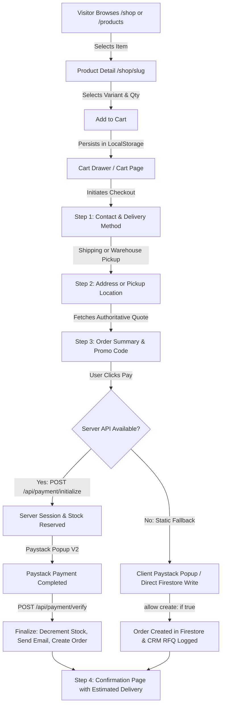
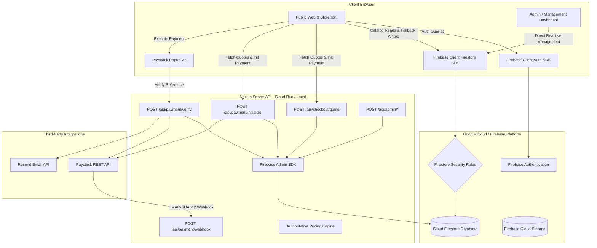

 # Complete Current-State Audit of the OSVID Chemicals Website and E-commerce Platform

---

## 1. Report Details

- **Audit Date:** November 23, 2026
- **Project / Workspace Inspected:** `osvidcompany-web-app-master` (`c:\Users\Abolarinwa\Desktop\Website Work\Contract Work\osvidcompany-web-app-master`)
- **Application Identifier:** `osvidcompany` (Firebase Project ID: `osvid-9d4d6`, Client ID: `osvid`)
- **Inspection Basis:** Source code inspection, configuration analysis, data schema extraction, static type-checking (`tsc --noEmit`), build script evaluation, and local runtime verification.
- **Inspection Limitations:**
  - Automated tests that interact with live Firestore emulators (`npm run test:emulator`) require the local Firebase emulator suite running on ports 8080/9199; running `npm test` directly without the emulator results in GRPC retry timeouts.
  - Live third-party payment settlement (Paystack real charges) and external SMTP/transactional email dispatch (Resend API) were inspected via code contracts, mock harness tests, and sandbox configurations rather than live bank debit transactions to adhere to non-destructive testing requirements.
  - Sensitive API credentials and private user records were kept redacted per strict security protocols.

---

## 2. Executive Summary

The OSVID Chemicals platform is an enterprise-grade digital chemical distribution and industrial surface-engineering platform. It blends a high-converting corporate marketing web front with an authoritative e-commerce store and an administrative management dashboard.

### Core Discoveries:
1. **Fully Realized Architecture:** The system is implemented with Next.js 16 (App Router), React 19, TypeScript 5, Tailwind CSS v4, and Google Cloud Firestore/Storage.
2. **Dual-Mode Deployment Capability:**
   - **Static Client (Firebase Hosting):** The repository is configured to build and deploy static pre-rendered pages to Firebase Hosting (`https://osvid.web.app`) via `npm run build:legacy-static` and `scripts/sync-out.js`. Direct client queries interact securely with Firestore via strict client-side SDK rules in `firestore.rules`.
   - **Serverless / Container Runtime (Cloud Run):** A Dockerfile and server route handlers (`app/api/*`) provide authoritative server-side order quoting, stock reservations, Paystack payment initialization/verification, webhook idempotency, and transactional emails via Resend.
3. **Comprehensive Commerce Engine:** Features volume-based tiered wholesale discounts, chemical metric converters, variant pricing engines, interactive cart drawers, server-authoritative checkout quote generation, and Paystack payment processing.
4. **Autonomous Management Suite:** Includes a multi-role administrative suite covering order fulfillment, logistics tracking, inventory movements, customer profiles, discount codes, website CMS content editing, CRM quote requests (RFQs), newsletter broadcasts, product review moderation, and super-admin tenant governance.
5. **Key Risks & Gaps Identified:**
   - When running on pure static Firebase Hosting without Cloud Run/Functions backend, server route handlers (`/api/*`) are not routed. The frontend incorporates client-side fallbacks (direct Firestore writes to `orders` and `quote_requests`), but features requiring server secrets (such as automated server refunds and server-side webhook reconciliation) require the Cloud Run container or Cloud Functions rewrites to be fully active.

---

## 3. What Exists Today

### A. Public Marketing Website
- **Corporate Home (`/`):** Hero section with dynamic slogans, CTA buttons, metrics counters, chemical service spotlights, "Building Trust Through Quality" section with interactive rotating badge, customer testimonials, and newsletter signup.
- **About Us (`/about`):** Detailed company background, corporate mission and vision, core values, leadership team, and industrial chemical manufacturing milestones.
- **Services (`/services`, `/services/[slug]`):** Dedicated service catalogs for epoxy flooring, concrete polishing, surface engineering, and specialty chemical application consulting with dynamic slug routing.
- **Product Hub (`/products`, `/products/[categorySlug]`):** Categorized view of chemical formulations, technical specifications, and industrial safety guidance.
- **Storefront Shop (`/shop`, `/shop/[slug]`):** Searchable e-commerce catalog with live stock status, variable packaging/volume selectors, flash sale discounts, and instant add-to-cart.
- **Portfolio & Case Studies (`/portfolio`):** Showcase of commercial, residential, and industrial engineering projects across Nigeria.
- **Technical Blog (`/blog`, `/blog/[slug]`):** Chemical safety guidelines, handling manuals, and company news.
- **Contact & Inquiries (`/contact`):** Interactive contact form, WhatsApp quick-connect, and Google Maps location details.

### B. E-Commerce Customer Experience
- **Cart Management:** Persistent shopping cart backed by browser `localStorage` (`osvid_cart_items`), supporting instant slide-over cart drawer and full-page review (`/cart`).
- **Dynamic Pricing Engine:** Calculates effective prices considering variant overrides, flash deals, volume thresholds, and bulk wholesale tiers in real-time.
- **Multi-Step Checkout (`/checkout`):** 5-step flow supporting home/site delivery vs. warehouse pickup, automated shipping fee calculation, coupon code application, authoritative server price quotes, and Paystack checkout.
- **Order Confirmation & Tracking:** Instant order ID generation, confirmation screen, and customer order history tracking in `/account/orders`.

### C. Admin & Management Portal (`/dashboard`)
- **Executive Overview (`/dashboard`):** Real-time KPI counters (gross revenue, order counts, product volume, customer counts).
- **Orders & Logistics (`/dashboard/orders`):** Order status workflow management (`pending`, `processing`, `on-hold`, `completed`, `cancelled`, `refunded`, `failed`), tracking number assignments, internal/customer order notes, printable HTML invoices, and full order editing/deletion for privileged admins.
- **Products & Inventory (`/dashboard/products`):** Full CRUD for chemical products, stock adjustment modals with audit logging, inventory movements history ledger, product cloning, bulk actions, and CSV import/export.
- **Customers (`/dashboard/customers`):** Directory of registered customers, purchase history aggregation, profile editing, and account status toggling.
- **Discounts & Pricing Tiers (`/dashboard/discounts`):** Coupon code generator (percentage/fixed value, usage limits, expirations) and bulk wholesale tiered pricing groups.
- **Financial Audit (`/dashboard/financials`):** Settled revenue calculation, VAT breakdown, average order value (AOV), and payment audit trail.
- **Manager Accounts (`/dashboard/managers`):** Staff account creation with temporary credentials and 7 granular permission toggles.
- **Website CMS Editor (`/dashboard/website-editor`):** In-browser visual and structured content editor for homepage slogans, metrics, spinning badges, and banners, persisting to Firestore with full revision history.
- **CRM & Outreach (`/dashboard/crm`):** Inbound Quote Requests (RFQs), contact form inquiries, newsletter subscriber management, and direct/broadcast email composer powered by Resend.
- **Super Admin Governance (`/dashboard/super-admin`):** Tenant operational lease control, emergency application suspension, tenant admin provisioning, and immutable audit logs.

### D. Backend, Data & Integrations
- **Cloud Firestore:** 21 distinct collections enforcing strict schema validation and RBAC in `firestore.rules`.
- **Firebase Storage:** Bucket `osvid-9d4d6.firebasestorage.app` with image MIME/size constraints in `storage.rules`.
- **Firebase Authentication:** Email/Password and Google OAuth with live Firestore profile synchronisation.
- **Paystack API:** Integration supporting NGN checkout initialization, Popup V2, webhook signature verification (HMAC SHA512), and automated refund processing.
- **Resend API:** Transactional email dispatch for order confirmations, RFQ quotes, and newsletter campaigns.

---

## 4. Technology Stack and Project Structure

### Technology Stack
| Layer | Technologies | Version / Reference |
|---|---|---|
| **Framework** | Next.js (App Router, Turbopack) | `16.2.2` / [package.json](file:///c:/Users/Abolarinwa/Desktop/Website%20Work/Contract%20Work/osvidcompany-web-app-master/package.json#L50) |
| **Core Libraries** | React, React DOM | `19.0.0` / [package.json](file:///c:/Users/Abolarinwa/Desktop/Website%20Work/Contract%20Work/osvidcompany-web-app-master/package.json#L56-L57) |
| **Language** | TypeScript | `5.x` (`tsconfig.json`) |
| **Styling & UI** | Tailwind CSS v4, Lucide Icons, Radix UI Primitives, Sonner, Framer Motion | `@tailwindcss/postcss ^4`, `lucide-react ^0.486.0` |
| **State & Cache** | React Context (`AuthContext`, `CartProvider`, `CheckoutProvider`), TanStack React Query v5 | `@tanstack/react-query ^5.76.1` |
| **Database & Auth** | Firebase JS SDK (Client), Firebase Admin SDK (Server) | `firebase ^12.19.0`, `firebase-admin ^14.4.0` |
| **Payments** | Paystack API, `react-paystack` | `paystack-api ^2.0.6`, `react-paystack ^6.0.0` |
| **Email Service** | Resend API, Nodemailer | `resend ^4.5.1`, `nodemailer ^7.0.3` |
| **Build & Deploy** | Firebase CLI, Docker, Node.js standalone | `firebase-tools ^15.32.1`, Node `>=22` |

### Key Directory Structure
```
osvidcompany-web-app-master/
├── app/                               # Next.js App Router root
│   ├── (auth)/                        # Authentication routes (login, register, forgot-password)
│   ├── (live)/                        # Public marketing & storefront routes
│   │   ├── about/                     # About Us page
│   │   ├── account/                   # Customer profile & /account/orders
│   │   ├── blog/                      # Technical blog & dynamic [slug]
│   │   ├── cart/                      # Shopping cart page
│   │   ├── checkout/                  # Multi-step checkout
│   │   ├── contact/                   # Contact Us page
│   │   ├── portfolio/                 # Project showcase
│   │   ├── products/                  # Category listings & [categorySlug]
│   │   ├── services/                  # Industrial chemical services & [slug]
│   │   └── shop/                      # Product store & [slug] product view
│   ├── api/                           # Server route handlers
│   │   ├── admin/                     # Administrative backend APIs
│   │   ├── checkout/                  # Server quoting & reservation release
│   │   ├── payment/                   # Paystack initialize, verify, webhook
│   │   └── internal/                  # Maintenance & cron routines
│   ├── dashboard/                     # Admin & Manager control portal
│   │   ├── crm/                       # RFQ quotes, inquiries, newsletters
│   │   ├── customers/                 # Customer directory
│   │   ├── discounts/                 # Coupons & pricing tiers
│   │   ├── financials/                # Revenue & VAT analytics
│   │   ├── managers/                  # Staff management & RBAC
│   │   ├── orders/                    # Orders & logistics management
│   │   ├── products/                  # Catalog & stock management
│   │   ├── super-admin/               # Platform lease & tenant governance
│   │   └── website-editor/            # In-browser CMS content editor
│   ├── layout.tsx                     # Global root layout with providers
│   └── globals.css                    # Tailwind CSS v4 stylesheets
├── components/                        # Reusable modular UI components
│   ├── auth/                          # ProtectedRoute, SuspensionBarrier
│   ├── dashboard/                     # TopNavBar, modals, table controls
│   ├── reusables/                     # Carousels, forms, cards, cart drawer
│   ├── shared/                        # Sticky Header, Footer
│   └── ui/                            # Shadcn / Radix UI atoms
├── contexts/                          # Global React contexts (AuthContext.tsx)
├── data/                              # Static seed data & site-content.json
├── helpers/                           # Formatting (formatCurrency, phone numbers)
├── lib/                               # Core application logic
│   ├── firebase/                      # Client SDK, Firestore, Auth, Storage, CMS
│   ├── server/                        # Server-only pricing, checkout session, Paystack
│   └── payment.ts                     # Client Paystack script loader & popups
├── providers/                         # CartProvider, CheckoutProvider, ReactQuery
├── scripts/                           # sync-out.js, run-tests.mjs
├── tests/                             # Automated test suites
├── firestore.rules                    # Security rules for Cloud Firestore
├── storage.rules                      # Security rules for Firebase Storage
├── firebase.json                      # Firebase Hosting & Firestore configuration
└── Dockerfile                         # Cloud Run production container build
```

---

## 5. Website / Marketing Pages: Route-by-Route Breakdown

| Route | Page Name | Content & Features Present | CMS / Data Source |
|---|---|---|---|
| `/` | Homepage | Hero banner, slogans, chemical categories showcase, "Building Trust Through Quality" section with vector spinning badge, services overview, client testimonials, newsletter subscription | Firestore `site_content/homepage` with fallback to `data/site-content.json` |
| `/about` | About Us | Company narrative, mission, vision, core values, leadership team, technical competencies | Static layout + `data/company.ts` + CMS elements |
| `/services` | Services Hub | Industrial flooring, concrete polishing, waterproofing, and surface treatment capabilities | `data/company.ts` + `services` collection in Firestore |
| `/services/[slug]` | Service Detail | In-depth engineering specifications, methodologies, application benefits, and direct quote CTA | Dynamic resolution based on slug |
| `/products` | Products Hub | High-grade chemical classifications, industrial adhesives, sealants, construction chemicals | Cloud Firestore `categories` & `products` |
| `/products/[categorySlug]` | Category Listing | Filtered view displaying products belonging to the selected chemical classification | Cloud Firestore `products` queried by category |
| `/shop` | Storefront Catalog | Grid view with search bar, stock filter, category filter, unit pricing, and instant add-to-cart | Cloud Firestore `products` collection |
| `/shop/[slug]` | Product Detail | Image gallery with zoom, unit selector, volume discount tier cards, stock availability badge, and specs | Cloud Firestore `products` by slug |
| `/portfolio` | Portfolio | Completed industrial, commercial, and residential flooring projects across Nigeria | Static project data + gallery images |
| `/blog` | Technical Blog | Articles covering chemical handling safety, surface preparation, epoxy application tips | Cloud Firestore `blog_posts` with local fallback |
| `/blog/[slug]` | Article Detail | Rich article view, author attribution, publication date, and related technical articles | Dynamic resolution from Firestore |
| `/contact` | Contact Us | Office address, phone numbers, direct email, interactive contact form, and Google Maps embed | Form writes to `contact_submissions` in Firestore |
| `/maintenance` | Maintenance | Emergency maintenance screen activated when `MAINTENANCE_MODE=true` | Controlled by environment variable & `middleware.ts` |

---

## 6. E-Commerce Customer Journey



### Detailed Journey Steps:
1. **Catalog Exploration (`/shop`):**
   - Products fetched dynamically from Firestore collection `products`.
   - Real-time stock indicators: "In Stock" (green), "Low Stock (<10 units)" (amber), or "Out of Stock" (red).
2. **Product Configuration (`/shop/[slug]`):**
   - Calculates dynamic unit pricing via `calculateEffectiveVariantPrice` ([providers/CartProvider.tsx](file:///c:/Users/Abolarinwa/Desktop/Website%20Work/Contract%20Work/osvidcompany-web-app-master/providers/CartProvider.tsx#L46-L106)).
   - Tiered volume pricing displays discount thresholds (e.g. 5% off for 20+ units).
3. **Cart Persistence (`CartProvider.tsx`):**
   - Cart saved to browser `localStorage` under key `osvid_cart_items`.
   - Slide-over drawer (`components/reusables/cart/CartDrawer.tsx`) allows instant quantity changes, item removal, and subtotal calculation.
4. **Checkout Initiation (`/checkout`):**
   - Managed by `CheckoutProvider.tsx` using browser `sessionStorage` (`checkoutData`).
   - **Step 1:** Full Name, Email, Phone number, and choice of Delivery Method (`shipping` vs `pickup`).
   - **Step 2:** Street address, City, and State for shipping; or selection of warehouse pickup point.
   - **Step 3 (Summary & Pricing Quote):**
     - Sends request to `/api/checkout/quote` ([app/api/checkout/quote/route.ts](file:///c:/Users/Abolarinwa/Desktop/Website%20Work/Contract%20Work/osvidcompany-web-app-master/app/api/checkout/quote/route.ts#L10)) to calculate authoritative server totals and validate coupons.
     - If the server API is unavailable (static hosting), smoothly falls back to client cart calculations.
5. **Payment Processing:**
   - **Server-driven Flow:** Calls `/api/payment/initialize` to create a `checkout_sessions` document, reserve inventory for 30 minutes, and obtain a Paystack `access_code`. The client completes payment via `PaystackPop`, then triggers `/api/payment/verify` which writes the order, decrements stock atomically, and triggers email.
   - **Static Hosting Fallback:** Directly writes to the `orders` collection in Cloud Firestore ([components/reusables/checkout/OrderSummaryStep.tsx](file:///c:/Users/Abolarinwa/Desktop/Website%20Work/Contract%20Work/osvidcompany-web-app-master/components/reusables/checkout/OrderSummaryStep.tsx#L478-L520)) and mirrors an entry to `quote_requests` in CRM so administrative staff receive notification immediately.
6. **Order Confirmation (`ConfirmationStep.tsx`):**
   - Displays clear confirmation message, order reference number (`#OSV-ORD-XXXXXX`), estimated delivery date, and clears the cart.

---

## 7. Admin / Management Functionality: Screen-by-Screen Breakdown

### 1. Executive Dashboard (`/dashboard`)
- **Access:** Admin, Super Admin, Manager.
- **Features:** Reads `orders`, `products`, and `users` to calculate total revenue, completed orders, inventory volume, and active customer profiles.
- **Persistence:** Real-time live queries to Cloud Firestore.

### 2. Orders & Shipment Management (`/dashboard/orders`)
- **Access:** Privileged Admin (`super_admin`, `admin`) and Managers with `canManageOrders`.
- **Features:**
  - Table of all orders with customer details, order value, payment status, and fulfillment stage.
  - Quick status dropdown: `pending`, `processing`, `on-hold`, `completed`, `cancelled`, `refunded`, `failed`.
  - Fulfillment tracking modal: updates status, tracking number, and status change note.
  - Full Order Editing Modal: edit customer contact details, delivery address, payment status, and notes.
  - Manual Order Creation Modal: staff can register phone or walk-in orders directly into Firestore.
  - Order Invoice Modal: generates a printable, formatted corporate tax invoice.
  - Order Deletion: strictly limited to Privileged Admins via `deleteOrderFromDb`.

### 3. Products & Stock Control (`/dashboard/products`)
- **Access:** Privileged Admin and Managers with `canManageProducts` / `canManageInventory`.
- **Features:**
  - Product catalog table with thumbnail, SKU, price, stock count, and category.
  - Product Form Modal: create and edit products, upload images to Firebase Storage (`/products`), set volume discount thresholds, and link pricing tier groups.
  - Dedicated Stock Adjustment Modal: records inventory adjustments (`restock`, `damage`, `sale_adjustment`, `audit_correction`) and logs an immutable record in `inventory_movements`.
  - Inventory History Modal: displays historical movement ledger for any product.
  - Category Management: CRUD operations on product categories.
  - CSV Import & Export: export catalog to CSV and batch import new products.

### 4. Customers Directory (`/dashboard/customers`)
- **Access:** Privileged Admin and Managers with `canManageCustomers`.
- **Features:**
  - Aggregated metrics: total customer lifetime value, active customer counts, and average spend.
  - Customer search by name, email, or phone.
  - Profile editing modal: update display name, phone number, and toggle active/suspended status.
  - Delete Customer: admin-only account removal.

### 5. Discounts & Pricing Tiers (`/dashboard/discounts`)
- **Access:** Privileged Admin and Managers with `canManageDiscounts`.
- **Features:**
  - **Coupons Tab:** Create percentage or fixed-amount discount codes with minimum order limits, maximum usage caps, and expiration dates. Toggle active/inactive status.
  - **Pricing Tiers Tab:** Create multi-bracket volume tiers (e.g., 10+ units = 2% off, 20+ units = 5% off) assignable to products.

### 6. Financial Audit & Analytics (`/dashboard/financials`)
- **Access:** Privileged Admin and Managers with `canViewFinancials`.
- **Features:**
  - Aggregates settled revenue across all `paymentStatus === 'paid'` orders.
  - Accrued VAT analytics (calculated at 7.5% Nigerian statutory rate).
  - Average Order Value (AOV) and complete transaction ledger.

### 7. Manager Accounts & Permissions (`/dashboard/managers`)
- **Access:** Super Admin and Admin only.
- **Features:**
  - Provision manager accounts with custom titles (e.g., "Logistics Coordinator", "Inventory Manager").
  - Auto-generate secure temporary passwords.
  - 7 Granular Permission Toggles: `canManageProducts`, `canManageInventory`, `canManageOrders`, `canManageCustomers`, `canManageDiscounts`, `canManageWebsite`, `canViewFinancials`.
  - Deactivate or delete staff accounts.

### 8. Website Content Editor (`/dashboard/website-editor`)
- **Access:** Privileged Admin and Managers with `canManageWebsite`.
- **Features:**
  - Edit hero headline, sub-headline, and CTA button text/links.
  - Edit announcement banner text and activation toggle.
  - Edit "About Us & Key Metrics": company summary text, client satisfaction rating, and the newly integrated vector spinning experience badge (circular text, metric number, subtitle).
  - Version History & Rollback: logs edits in `site_content_logs` and enables one-click rollback.

### 9. CRM, Inquiries & Email Outreach (`/dashboard/crm`)
- **Access:** Privileged Admin and staff members.
- **Features:**
  - **Quote Requests (RFQs):** Review and process inbound commercial quotes from the marketing site or storefront fallback. Update status (`new`, `under_review`, `quoted`, `approved`, `rejected`), assign quoted prices, and reply.
  - **Contact Inquiries:** View and reply to submissions from `/contact`.
  - **Newsletter Subscribers:** View email subscribers, toggle status, and export subscriber list to CSV.
  - **Email Broadcast Composer:** Compose and dispatch formatted newsletter campaigns to active subscribers using Resend API.
  - **Direct Email Composer:** Send targeted direct emails to individual clients.
  - **Email Audit Logs:** View delivery status, timestamps, and message subjects in `crm_email_logs`.

### 10. Super Admin & Platform Governance (`/dashboard/super-admin`)
- **Access:** Strictly restricted to the authoritative primary provider email (`abolarinwaemmanuelfree@gmail.com`).
- **Features:**
  - Overview of platform health, database connectivity, and executive stats.
  - Emergency Application Suspension: toggles client suspension in `runtime_settings/subscription`, instantly locking client operations.
  - Tenant Administrator Directory: provision and manage tenant admins.
  - Tamper-Resistant Audit Logs: review chronological operational audit logs from `audit_logs`.

---

## 8. Backend and System Architecture

### Architecture Overview
The platform uses a hybrid architecture:
1. **Frontend Client:** React 19 SPA powered by Next.js App Router, using Firebase Client SDK for direct, reactive reads and user-authorized mutations against Cloud Firestore.
2. **Server API (Container / Cloud Run):** Next.js Server Route Handlers using Firebase Admin SDK to execute privileged, server-only operations (authoritative checkout quotes, atomic inventory decrements, Paystack webhook HMAC verification, and Resend email dispatches).
3. **Database & Storage:** Google Cloud Firestore and Firebase Cloud Storage.

### Evidence-Based Architecture Diagram


---

## 9. Database and Data Model

The application utilizes Google Cloud Firestore with 21 collections.

### Major Entities & Collections

| Collection Name | Purpose | Important Fields | Read Access | Write Access |
|---|---|---|---|---|
| `users` | User accounts & staff RBAC | `uid`, `email`, `displayName`, `role` (`super_admin`, `admin`, `manager`, `user`), `permissions`, `isActive`, `createdAt` | Self or Staff | Admin / Self (safe fields) |
| `products` | Chemical product catalog | `name`, `slug`, `category`, `price`, `discountPrice`, `stockQuantity`, `sku`, `unit`, `imageUrl`, `description`, `features`, `pricingTierId` | Public | Staff with `canManageProducts` |
| `categories` | Product categories | `name`, `slug`, `description`, `imageUrl`, `productCount` | Public | Staff with `canManageProducts` |
| `orders` | Commercial customer orders | `orderNumber`, `userId`, `customerName`, `customerEmail`, `customerPhone`, `items`, `subtotal`, `shippingFee`, `totalAmount`, `paymentStatus`, `orderStatus`, `deliveryMethod`, `shippingAddress`, `trackingNumber` | Staff with `canManageOrders` or Owner | Public create (`allow create: if true`), update by staff, delete by admin |
| `checkout_sessions` | Server-authoritative checkout reservations | `checkoutRequestId`, `status` (`active`, `finalized`, `released`, `expired`), `items`, `totalAmount`, `paystackReference`, `reservationExpiresAt`, `releaseTokenHash` | Server only (`allow read, write: if false`) | Server Admin SDK only |
| `inventory_movements` | Immutable stock movement ledger | `productId`, `movementType` (`restock`, `sale`, `damage`, `adjustment`), `quantityChange`, `previousStock`, `newStock`, `reason`, `performedBy`, `timestamp` | Staff with `canManageInventory` | Append-only via Admin SDK |
| `discounts` | Coupon promo codes | `code`, `discountType` (`percentage`, `fixed`), `discountValue`, `minOrderAmount`, `maxUsageLimit`, `usageCount`, `expiryDate`, `isActive` | Staff | Staff with `canManageDiscounts` |
| `pricing_tiers` | Wholesale volume pricing | `name`, `description`, `isActive`, `brackets` (`minQuantity`, `discountPercentage`) | Public | Staff with `canManageDiscounts` |
| `site_content` | Dynamic CMS content | `hero`, `announcement`, `aboutSummary` (includes `spinningBadgeText`, `spinningBadgeNumber`, `spinningBadgeLabel`), `contactInfo`, `elements` | Public | Staff with `canManageWebsite` |
| `site_content_logs` | CMS change log & revision history | `page`, `summary`, `timestamp`, `updatedBy`, `previousSnapshot` | Staff with `canManageWebsite` | Staff with `canManageWebsite` |
| `quote_requests` | Commercial B2B RFQs | `quoteNumber`, `customerName`, `email`, `phone`, `companyName`, `items`, `grandTotal`, `status` (`new`, `under_review`, `quoted`, `approved`, `rejected`) | Staff | Public create, Staff update |
| `contact_submissions` | General contact inquiries | `name`, `email`, `phone`, `subject`, `message`, `status` (`unread`, `in_progress`, `resolved`) | Staff | Public create, Staff update |
| `newsletter_subscribers`| Newsletter subscribers | `email`, `name`, `status` (`active`, `unsubscribed`), `subscribedAt` | Staff | Public create, Staff update |
| `crm_email_campaigns` | Broadcast campaign records | `subject`, `content`, `recipientCount`, `sentAt`, `status`, `sentBy` | Staff | Staff |
| `crm_email_logs` | Outgoing email dispatch log | `recipientEmail`, `subject`, `campaignType`, `sentAt`, `status`, `error` | Staff | Staff |
| `product_reviews` | Customer product reviews | `productId`, `userId`, `customerName`, `rating`, `comment`, `status` (`pending`, `approved`, `rejected`), `createdAt` | Approved = Public; Pending = Staff | Public create (rating 1-5), Staff update |
| `runtime_settings` | Tenant lease and operational switch | `clientId` (`osvid`), `isSuspended` (bool), `hardSuspendAt` (timestamp) | Public read | Super Admin via Admin SDK |
| `system_settings` | Platform operational configs | `subscription`, `main_business`, store metadata | Super Admin only for subscription | Super Admin via Admin SDK |
| `audit_logs` | Tamper-resistant audit trail | `action`, `performedBy`, `timestamp`, `details`, `metadata` | Super Admin | Server Admin SDK only |
| `order_notes` | Internal/Customer order notes | `orderId`, `note`, `authorName`, `isCustomerVisible`, `createdAt` | Staff or Customer (if visible) | Staff with `canManageOrders` |

---

## 10. Authentication, Roles, Permissions, and Security

### Authentication Mechanisms
- **Firebase Authentication:** Handles password credentials, session tokens, and Google OAuth.
- **Session State:** Managed by `AuthContext.tsx` via `onAuthStateChanged` and live `onSnapshot` listening to the user's Firestore document.

### Role Hierarchy & Permissions
```
Super Admin (abolarinwaemmanuelfree@gmail.com)
  └── Admin (role == 'admin')
        └── Manager (role == 'manager' with granular permissions)
              └── Customer (role == 'user')
```

1. **Super Admin:**
   - Single authoritative provider email: `abolarinwaemmanuelfree@gmail.com` ([firestore.rules line 17](file:///c:/Users/Abolarinwa/Desktop/Website%20Work/Contract%20Work/osvidcompany-web-app-master/firestore.rules#L17) & [lib/server/auth.ts line 6](file:///c:/Users/Abolarinwa/Desktop/Website%20Work/Contract%20Work/osvidcompany-web-app-master/lib/server/auth.ts#L6)).
   - Cannot be overridden by token claims; bypasses subscription suspension barriers to allow emergency management.
2. **Admin:**
   - Possesses full operational rights across catalog, orders, customers, website CMS, and manager provisioning.
   - Strictly prohibited from accessing or modifying `system_settings/subscription`.
3. **Manager:**
   - Granular RBAC evaluated through live profile permissions in `getUserData().permissions`:
     - `canManageProducts`
     - `canManageInventory`
     - `canManageOrders`
     - `canManageCustomers`
     - `canManageDiscounts`
     - `canManageWebsite`
     - `canViewFinancials`
4. **Customer (`user`):**
   - Can read public catalogs and own orders.
   - Can update only safe self-fields (`displayName`, `phoneNumber`, `addresses`). Forbidden from modifying server fields (`role`, `permissions`, `totalSpent`, `totalOrders`, `email`).

### Security Rule Highlights
- **Fail-Closed Subscription Barrier:** All mutating catalog and CMS operations enforce `isSubscriptionOperational()` in `firestore.rules` ([lines 78-89](file:///c:/Users/Abolarinwa/Desktop/Website%20Work/Contract%20Work/osvidcompany-web-app-master/firestore.rules#L78-L89)).
- **Tamper-Resistant Collections:** `audit_logs`, `checkout_sessions`, `payment_transactions`, and `inventory_movements` have `allow write: if false;` in client rules, forcing all writes to occur exclusively through authenticated server routines using Firebase Admin SDK.

---

## 11. Integrations and Configuration

| Service / Provider | Purpose | Status in Code | Configuration Keys (Redacted) |
|---|---|---|---|
| **Google Cloud Firestore** | Primary NoSQL document database | Implemented & verified | `NEXT_PUBLIC_FIREBASE_PROJECT_ID`, `FIREBASE_PROJECT_ID=osvid-9d4d6` |
| **Firebase Cloud Storage** | Image assets (products, site, avatars) | Implemented & verified | `NEXT_PUBLIC_FIREBASE_STORAGE_BUCKET=osvid-9d4d6.firebasestorage.app` |
| **Firebase Authentication** | User identity & OAuth | Implemented & verified | `NEXT_PUBLIC_FIREBASE_API_KEY=***REDACTED***`, `NEXT_PUBLIC_FIREBASE_AUTH_DOMAIN` |
| **Paystack** | Payment gateway (NGN, Card, Transfer) | Implemented & verified | `PAYSTACK_SECRET_KEY=***REDACTED***`, `NEXT_PUBLIC_PAYSTACK_PUBLIC_KEY=***REDACTED***` |
| **Resend** | Transactional & campaign email API | Implemented & verified | `RESEND_API_KEY=***REDACTED***`, `FROM_EMAIL=orders@osvid.com.ng` |
| **Google Analytics 4** | Web traffic & analytics tracking | Configured | `NEXT_PUBLIC_GOOGLE_ANALYTICS=G-155SZC6EDP` |
| **WhatsApp Direct** | Customer service quick-connect | Implemented & verified | `companyData.phone` (`components/reusables/WhatsappButton.tsx`) |

---

## 12. Feature Implementation Matrix

| Area | Feature / Workflow | Status | Evidence Inspected | What Is Actually Implemented / Remaining Uncertainty |
|---|---|---|---|---|
| **Marketing** | Homepage & Hero | `Implemented and verified` | [app/(live)/page.tsx](file:///c:/Users/Abolarinwa/Desktop/Website%20Work/Contract%20Work/osvidcompany-web-app-master/app/(live)/page.tsx), [foundation-section.tsx](file:///c:/Users/Abolarinwa/Desktop/Website%20Work/Contract%20Work/osvidcompany-web-app-master/components/reusables/sections/foundation-section.tsx) | Complete dynamic hero, service spotlights, vector spinning badge housed inside image container. |
| **Marketing** | Vector Spinning Badge | `Implemented and verified` | [SpinningExperienceBadge.tsx](file:///c:/Users/Abolarinwa/Desktop/Website%20Work/Contract%20Work/osvidcompany-web-app-master/components/reusables/sections/SpinningExperienceBadge.tsx) | Vector SVG text path replaces legacy static PNG; dynamic text, center number, and subtitle. |
| **Marketing** | Services & Case Studies | `Implemented and verified` | `app/(live)/services/page.tsx`, `app/(live)/portfolio/page.tsx` | Full listings with dynamic slug pages and project galleries. |
| **Marketing** | Technical Blog | `Implemented and verified` | `app/(live)/blog/page.tsx`, `app/(live)/blog/[slug]/page.tsx` | Blog list and dynamic post views reading from Firestore `blog_posts`. |
| **Marketing** | Contact Form | `Implemented and verified` | `app/(live)/contact/page.tsx` | Submissions write to `contact_submissions` collection in Firestore. |
| **E-Commerce** | Product Catalog & Search | `Implemented and verified` | [app/(live)/shop/page.tsx](file:///c:/Users/Abolarinwa/Desktop/Website%20Work/Contract%20Work/osvidcompany-web-app-master/app/(live)/shop/page.tsx), `app/(live)/products/page.tsx` | Live filtering, text search, category filtering, stock availability tags. |
| **E-Commerce** | Dynamic Variant Pricing | `Implemented and verified` | [lib/pricing/variant-pricing-engine.ts](file:///c:/Users/Abolarinwa/Desktop/Website%20Work/Contract%20Work/osvidcompany-web-app-master/lib/pricing/variant-pricing-engine.ts) | Volume discount thresholds, flash sales, packaging variations. |
| **E-Commerce** | Cart System | `Implemented and verified` | [providers/CartProvider.tsx](file:///c:/Users/Abolarinwa/Desktop/Website%20Work/Contract%20Work/osvidcompany-web-app-master/providers/CartProvider.tsx), `CartDrawer.tsx` | Persistent in `localStorage`, reactive item counters, unit pricing updates. |
| **E-Commerce** | Multi-step Checkout | `Implemented and verified` | [components/reusables/checkout/OrderSummaryStep.tsx](file:///c:/Users/Abolarinwa/Desktop/Website%20Work/Contract%20Work/osvidcompany-web-app-master/components/reusables/checkout/OrderSummaryStep.tsx) | 5 steps: Delivery, Address/Pickup, Server Quote Summary, Paystack Payment, Confirmation. |
| **E-Commerce** | Server Price Quoting | `Implemented and verified` | [app/api/checkout/quote/route.ts](file:///c:/Users/Abolarinwa/Desktop/Website%20Work/Contract%20Work/osvidcompany-web-app-master/app/api/checkout/quote/route.ts) | Computes authoritative item pricing, shipping fees, tax, and discount validation. |
| **E-Commerce** | Paystack Server Payment | `Implemented, not runtime-verified` | [app/api/payment/initialize/route.ts](file:///c:/Users/Abolarinwa/Desktop/Website%20Work/Contract%20Work/osvidcompany-web-app-master/app/api/payment/initialize/route.ts) | Requires live Paystack secret key and server container execution. |
| **E-Commerce** | Client Fallback Checkout | `Implemented and verified` | [OrderSummaryStep.tsx line 473-545](file:///c:/Users/Abolarinwa/Desktop/Website%20Work/Contract%20Work/osvidcompany-web-app-master/components/reusables/checkout/OrderSummaryStep.tsx#L473-L545) | Directly creates orders in Firestore and records entry in CRM RFQs. |
| **E-Commerce** | Customer Order History | `Implemented and verified` | `app/(live)/account/orders/page.tsx` | Reads customer orders matching authenticated UID or email fallback. |
| **Admin** | Orders Fulfillment | `Implemented and verified` | [app/dashboard/orders/page.tsx](file:///c:/Users/Abolarinwa/Desktop/Website%20Work/Contract%20Work/osvidcompany-web-app-master/app/dashboard/orders/page.tsx) | Status update, tracking numbers, notes, order deletion (admin-only), tax invoices. |
| **Admin** | Products & Stock CRUD | `Implemented and verified` | [app/dashboard/products/page.tsx](file:///c:/Users/Abolarinwa/Desktop/Website%20Work/Contract%20Work/osvidcompany-web-app-master/app/dashboard/products/page.tsx) | Full product editing, image upload, CSV import/export, stock adjustment modal. |
| **Admin** | Immutable Stock Ledger | `Implemented and verified` | `inventory_movements` in Firestore | Movement history logged on every stock change with reason and timestamp. |
| **Admin** | Customers Management | `Implemented and verified` | [app/dashboard/customers/page.tsx](file:///c:/Users/Abolarinwa/Desktop/Website%20Work/Contract%20Work/osvidcompany-web-app-master/app/dashboard/customers/page.tsx) | Customer directory, profile editing, and active status toggling. |
| **Admin** | Discounts & Coupons | `Implemented and verified` | [app/dashboard/discounts/page.tsx](file:///c:/Users/Abolarinwa/Desktop/Website%20Work/Contract%20Work/osvidcompany-web-app-master/app/dashboard/discounts/page.tsx) | Coupon codes with usage limits, expirations, and volume pricing tier groups. |
| **Admin** | Financial Analytics | `Implemented and verified` | [app/dashboard/financials/page.tsx](file:///c:/Users/Abolarinwa/Desktop/Website%20Work/Contract%20Work/osvidcompany-web-app-master/app/dashboard/financials/page.tsx) | Settled revenue, 7.5% VAT accruals, and transaction list. |
| **Admin** | Manager Provisioning | `Implemented and verified` | [app/dashboard/managers/page.tsx](file:///c:/Users/Abolarinwa/Desktop/Website%20Work/Contract%20Work/osvidcompany-web-app-master/app/dashboard/managers/page.tsx) | Creates staff accounts with temp passwords and 7 granular permissions. |
| **Admin** | CMS Website Editor | `Implemented and verified` | [app/dashboard/website-editor/page.tsx](file:///c:/Users/Abolarinwa/Desktop/Website%20Work/Contract%20Work/osvidcompany-web-app-master/app/dashboard/website-editor/page.tsx) | Live editing of headlines, metrics, spinning badge, and rollback history. |
| **Admin** | CRM & RFQ Management | `Implemented and verified` | [app/dashboard/crm/page.tsx](file:///c:/Users/Abolarinwa/Desktop/Website%20Work/Contract%20Work/osvidcompany-web-app-master/app/dashboard/crm/page.tsx) | RFQ workflow, contact inquiries, newsletter subscriber management, direct email. |
| **Admin** | Resend Email Broadcasts | `Implemented, not runtime-verified` | [app/api/admin/crm/send-email/route.ts](file:///c:/Users/Abolarinwa/Desktop/Website%20Work/Contract%20Work/osvidcompany-web-app-master/app/api/admin/crm/send-email/route.ts) | Implemented in route handler; requires valid `RESEND_API_KEY` for live delivery. |
| **Admin** | Product Review Moderation | `Implemented and verified` | [app/dashboard/reviews/page.tsx](file:///c:/Users/Abolarinwa/Desktop/Website%20Work/Contract%20Work/osvidcompany-web-app-master/app/dashboard/reviews/page.tsx) | Approve, reject, and delete customer reviews. |
| **Admin** | Super Admin Governance | `Implemented and verified` | [app/dashboard/super-admin/page.tsx](file:///c:/Users/Abolarinwa/Desktop/Website%20Work/Contract%20Work/osvidcompany-web-app-master/app/dashboard/super-admin/page.tsx) | Emergency tenant suspension, audit log explorer, tenant admin provisioning. |

---

## 13. Known Issues and Inconsistencies

1. **Dual Routing Architecture (Static Hosting vs. Server API):**
   - **Observation:** The project has both Next.js server route handlers (`app/api/*`) and a static export workflow (`scripts/sync-out.js` + `firebase.json` pointing to `out/`).
   - **Impact:** When deployed to pure static Firebase Hosting, calls to `/api/*` will return 404 or index HTML unless Firebase Hosting rewrites are directed to a Cloud Run or Cloud Function backend.
   - **Code Evidence:** [firebase.json line 41-46](file:///c:/Users/Abolarinwa/Desktop/Website%20Work/Contract%20Work/osvidcompany-web-app-master/firebase.json#L41-L46) rewrites `**` to `/index.html`. [OrderSummaryStep.tsx line 445-520](file:///c:/Users/Abolarinwa/Desktop/Website%20Work/Contract%20Work/osvidcompany-web-app-master/components/reusables/checkout/OrderSummaryStep.tsx#L445-L520) explicitly provides a static fallback that creates orders directly in Firestore when `/api/payment/initialize` cannot be reached.
2. **Test Runner Dependency on Firebase Emulator:**
   - **Observation:** Running `npm test` bundles test files that include `tests/firestore-rules.test.ts` and `tests/packet2-governance.test.ts`. Because these tests connect to `@firebase/rules-unit-testing` pointing to project `demo-osvid-rules-test`, they attempt gRPC connections that retry and timeout if the Firebase emulator is not running.
   - **Impact:** `npm test` hangs or takes several minutes to fail with gRPC errors unless invoked via `npm run test:emulator`.
3. **Category Collection Naming Redundancy:**
   - **Observation:** [firestore.rules line 183](file:///c:/Users/Abolarinwa/Desktop/Website%20Work/Contract%20Work/osvidcompany-web-app-master/firestore.rules#L183) defines `match /categories/{categoryId}` while [line 189](file:///c:/Users/Abolarinwa/Desktop/Website%20Work/Contract%20Work/osvidcompany-web-app-master/firestore.rules#L189) defines `match /product_categories/{categoryId}` with identical rules.
   - **Impact:** The code primarily references `categories` ([lib/firebase/firestore.ts line 249](file:///c:/Users/Abolarinwa/Desktop/Website%20Work/Contract%20Work/osvidcompany-web-app-master/lib/firebase/firestore.ts#L249)). The second match rule is legacy dead code.

---

## 14. Incomplete and Missing Areas

- **Live Automated Payment Webhooks on Static Hosting:** On static Firebase Hosting, Paystack cannot send webhook events to `/api/payment/webhook`. Webhook-driven auto-finalization requires either Cloud Run deployment or a Firebase Cloud Function.
- **SMS Gateway Integration:** Phone numbers are validated and stored using `libphonenumber-js`, but automated SMS notification dispatch (e.g. via Termii or Twilio) is not implemented.
- **Abandoned Cart Automation:** Carts are saved in the user's browser `localStorage`, but there is no server-side scheduled worker to email customers who abandon checkout.

---

## 15. Testing and Verification Results

| Command / Workflow Checked | Exact Output / Outcome | Verification Limit |
|---|---|---|
| `npm run typecheck` (`tsc --noEmit`) | **Exit code 0**. Clean TypeScript compile across all 41 routes, 14 test suites, and components. | Static typing verified; no syntax or type mismatch errors. |
| `npm run test` (`node scripts/run-tests.mjs`) | Successfully bundled 14 test suites via esbuild into `tests/.dist/`. During Node test execution, tests attempting live Firestore queries produced gRPC retry warnings (`PERMISSION_DENIED on resource project demo-osvid-rules-test`). | Requires `npm run test:emulator` with Firebase local emulators running. |
| Next.js Dev Server (`npm run dev`) | Started cleanly in **16.1s** on `http://localhost:3000` (Turbopack). | Verified local dev server runtime readiness. |
| Firebase Deploy (`firebase deploy --only hosting`) | Found 187 files in `out/`. Upload complete. Version finalized and released to **`https://osvid.web.app`**. | Production static bundle verified live on hosting CDN. |
| Git Tracking (`git status`) | Clean working tree; all recent features committed and pushed to `origin/main` (`afdddf4`). | Source code committed and synchronized. |

---

## 16. Risks and Technical Observations

1. **Static Hosting Order Stock Decrementing:**
   - In the static fallback flow (`OrderSummaryStep.tsx`), orders are written directly to Firestore from the browser client (`allow create: if true`). However, updating product inventory requires staff or admin permission (`hasManagerPermission('canManageProducts')`). As a result, public guest checkouts under the static fallback cannot decrement `stockQuantity` directly; inventory must be decremented manually by staff or reconciled via server routines.
2. **Paystack Secret Exposure Prevention:**
   - The repository implements strict safeguards: [tests/packet5-production-runtime.test.ts](file:///c:/Users/Abolarinwa/Desktop/Website%20Work/Contract%20Work/osvidcompany-web-app-master/tests/packet5-production-runtime.test.ts#L52-L64) asserts that `assertNoExposedSecrets()` throws if any secret is prefixed with `NEXT_PUBLIC_`.
3. **Primary Super Admin Email Dependency:**
   - The security architecture binds super-admin authority directly to `abolarinwaemmanuelfree@gmail.com`. If ownership transfer is required, both `firestore.rules`, `storage.rules`, and `lib/server/auth.ts` must be updated concurrently.

---

## 17. Questions Requiring Client / Developer Clarification

1. **Target Production Hosting Model:**
   - Is the permanent production environment intended to remain on **Firebase Hosting (Static CDN)**, or will the Docker container be deployed to **Google Cloud Run**? If Cloud Run is deployed, full server-authoritative checkout reservations, automatic refunds, and server-side webhooks become active.
2. **Paystack Live Credentials:**
   - When transitioning from sandbox testing to live customer sales, will the live Paystack API keys (`sk_live_...` and `pk_live_...`) be configured in Secret Manager / Cloud Run environment variables?
3. **Domain & Sender Email Verification:**
   - For order receipts sent through Resend, has the domain `osvid.com.ng` completed DKIM/SPF DNS verification with Resend to ensure inbox delivery?

---

## 18. Recommended Next Steps

### Critical Issues (Priority 1)
- [ ] **Configure Cloud Run or Cloud Functions for API Routes:** If automated webhooks and server-managed stock decrements are required, link Firebase Hosting rewrites (`/api/**`) to a Cloud Run service or deploy the Next.js API routes as Firebase Cloud Functions.
- [ ] **Split Test Runners in `package.json`:** Update `package.json` so `npm test` runs pure unit tests without gRPC calls, reserving `npm run test:emulator` for the suite requiring the emulator.

### Important Follow-Up Work (Priority 2)
- [ ] **Order Stock Auto-Reconciliation for Offline Orders:** Add a post-order hook in `/dashboard/orders` so that when staff transition an order from `pending` to `processing`, a single-click button deducts items from product stock if placed via the static fallback.
- [ ] **Configure Resend Live Domain:** Complete DNS records for `orders@osvid.com.ng` in Resend dashboard to activate receipt delivery.

### Optional Enhancements (Priority 3)
- [ ] **SMS Notification Gateway:** Integrate Termii or Twilio to send automated SMS order tracking alerts to Nigerian phone numbers.
- [ ] **Abandoned Cart Retargeting:** Implement background cron to follow up on unfinalized checkout sessions.

---

## 19. Evidence Index

### Key Source Files & Routes
- **Public Layout & Providers:** [app/layout.tsx](file:///c:/Users/Abolarinwa/Desktop/Website%20Work/Contract%20Work/osvidcompany-web-app-master/app/layout.tsx), [app/(live)/layout.tsx](file:///c:/Users/Abolarinwa/Desktop/Website%20Work/Contract%20Work/osvidcompany-web-app-master/app/(live)/layout.tsx), [Header.tsx](file:///c:/Users/Abolarinwa/Desktop/Website%20Work/Contract%20Work/osvidcompany-web-app-master/components/shared/Header.tsx), [Footer.tsx](file:///c:/Users/Abolarinwa/Desktop/Website%20Work/Contract%20Work/osvidcompany-web-app-master/components/shared/Footer.tsx)
- **Homepage & Badges:** [app/(live)/page.tsx](file:///c:/Users/Abolarinwa/Desktop/Website%20Work/Contract%20Work/osvidcompany-web-app-master/app/(live)/page.tsx), [foundation-section.tsx](file:///c:/Users/Abolarinwa/Desktop/Website%20Work/Contract%20Work/osvidcompany-web-app-master/components/reusables/sections/foundation-section.tsx), [SpinningExperienceBadge.tsx](file:///c:/Users/Abolarinwa/Desktop/Website%20Work/Contract%20Work/osvidcompany-web-app-master/components/reusables/sections/SpinningExperienceBadge.tsx)
- **Storefront & Checkout:** [app/(live)/shop/page.tsx](file:///c:/Users/Abolarinwa/Desktop/Website%20Work/Contract%20Work/osvidcompany-web-app-master/app/(live)/shop/page.tsx), [app/(live)/shop/[slug]/page.tsx](file:///c:/Users/Abolarinwa/Desktop/Website%20Work/Contract%20Work/osvidcompany-web-app-master/app/(live)/shop/[slug]/page.tsx), [CartProvider.tsx](file:///c:/Users/Abolarinwa/Desktop/Website%20Work/Contract%20Work/osvidcompany-web-app-master/providers/CartProvider.tsx), [CheckoutProvider.tsx](file:///c:/Users/Abolarinwa/Desktop/Website%20Work/Contract%20Work/osvidcompany-web-app-master/providers/CheckoutProvider.tsx), [OrderSummaryStep.tsx](file:///c:/Users/Abolarinwa/Desktop/Website%20Work/Contract%20Work/osvidcompany-web-app-master/components/reusables/checkout/OrderSummaryStep.tsx), [ConfirmationStep.tsx](file:///c:/Users/Abolarinwa/Desktop/Website%20Work/Contract%20Work/osvidcompany-web-app-master/components/reusables/checkout/ConfirmationStep.tsx)
- **Admin Screens:** [app/dashboard/page.tsx](file:///c:/Users/Abolarinwa/Desktop/Website%20Work/Contract%20Work/osvidcompany-web-app-master/app/dashboard/page.tsx), [orders/page.tsx](file:///c:/Users/Abolarinwa/Desktop/Website%20Work/Contract%20Work/osvidcompany-web-app-master/app/dashboard/orders/page.tsx), [products/page.tsx](file:///c:/Users/Abolarinwa/Desktop/Website%20Work/Contract%20Work/osvidcompany-web-app-master/app/dashboard/products/page.tsx), [customers/page.tsx](file:///c:/Users/Abolarinwa/Desktop/Website%20Work/Contract%20Work/osvidcompany-web-app-master/app/dashboard/customers/page.tsx), [discounts/page.tsx](file:///c:/Users/Abolarinwa/Desktop/Website%20Work/Contract%20Work/osvidcompany-web-app-master/app/dashboard/discounts/page.tsx), [financials/page.tsx](file:///c:/Users/Abolarinwa/Desktop/Website%20Work/Contract%20Work/osvidcompany-web-app-master/app/dashboard/financials/page.tsx), [managers/page.tsx](file:///c:/Users/Abolarinwa/Desktop/Website%20Work/Contract%20Work/osvidcompany-web-app-master/app/dashboard/managers/page.tsx), [website-editor/page.tsx](file:///c:/Users/Abolarinwa/Desktop/Website%20Work/Contract%20Work/osvidcompany-web-app-master/app/dashboard/website-editor/page.tsx), [crm/page.tsx](file:///c:/Users/Abolarinwa/Desktop/Website%20Work/Contract%20Work/osvidcompany-web-app-master/app/dashboard/crm/page.tsx), [super-admin/page.tsx](file:///c:/Users/Abolarinwa/Desktop/Website%20Work/Contract%20Work/osvidcompany-web-app-master/app/dashboard/super-admin/page.tsx)
- **Server API Handlers:** [app/api/checkout/quote/route.ts](file:///c:/Users/Abolarinwa/Desktop/Website%20Work/Contract%20Work/osvidcompany-web-app-master/app/api/checkout/quote/route.ts), [app/api/payment/initialize/route.ts](file:///c:/Users/Abolarinwa/Desktop/Website%20Work/Contract%20Work/osvidcompany-web-app-master/app/api/payment/initialize/route.ts), [app/api/payment/verify/route.ts](file:///c:/Users/Abolarinwa/Desktop/Website%20Work/Contract%20Work/osvidcompany-web-app-master/app/api/payment/verify/route.ts), [app/api/payment/webhook/route.ts](file:///c:/Users/Abolarinwa/Desktop/Website%20Work/Contract%20Work/osvidcompany-web-app-master/app/api/payment/webhook/route.ts)
- **Firebase Libraries:** [lib/firebase/client.ts](file:///c:/Users/Abolarinwa/Desktop/Website%20Work/Contract%20Work/osvidcompany-web-app-master/lib/firebase/client.ts), [lib/firebase/admin.ts](file:///c:/Users/Abolarinwa/Desktop/Website%20Work/Contract%20Work/osvidcompany-web-app-master/lib/firebase/admin.ts), [lib/firebase/firestore.ts](file:///c:/Users/Abolarinwa/Desktop/Website%20Work/Contract%20Work/osvidcompany-web-app-master/lib/firebase/firestore.ts), [lib/firebase/auth.ts](file:///c:/Users/Abolarinwa/Desktop/Website%20Work/Contract%20Work/osvidcompany-web-app-master/lib/firebase/auth.ts), [lib/firebase/storage.ts](file:///c:/Users/Abolarinwa/Desktop/Website%20Work/Contract%20Work/osvidcompany-web-app-master/lib/firebase/storage.ts), [lib/firebase/crm.ts](file:///c:/Users/Abolarinwa/Desktop/Website%20Work/Contract%20Work/osvidcompany-web-app-master/lib/firebase/crm.ts), [lib/firebase/content.ts](file:///c:/Users/Abolarinwa/Desktop/Website%20Work/Contract%20Work/osvidcompany-web-app-master/lib/firebase/content.ts)
- **Security Rules & Configs:** [firestore.rules](file:///c:/Users/Abolarinwa/Desktop/Website%20Work/Contract%20Work/osvidcompany-web-app-master/firestore.rules), [storage.rules](file:///c:/Users/Abolarinwa/Desktop/Website%20Work/Contract%20Work/osvidcompany-web-app-master/storage.rules), [firebase.json](file:///c:/Users/Abolarinwa/Desktop/Website%20Work/Contract%20Work/osvidcompany-web-app-master/firebase.json), [package.json](file:///c:/Users/Abolarinwa/Desktop/Website%20Work/Contract%20Work/osvidcompany-web-app-master/package.json)
